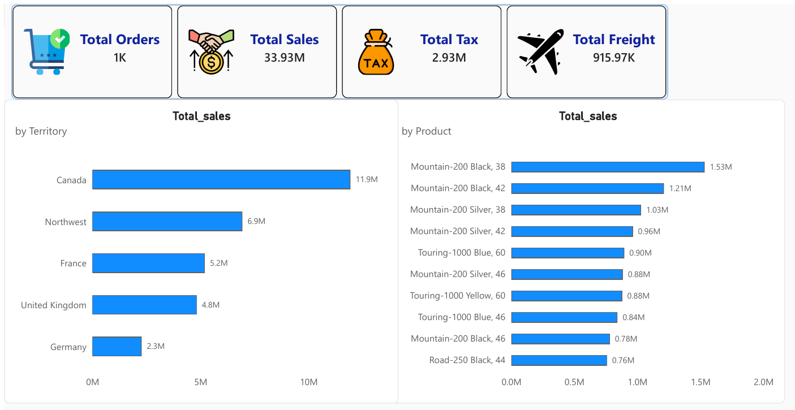
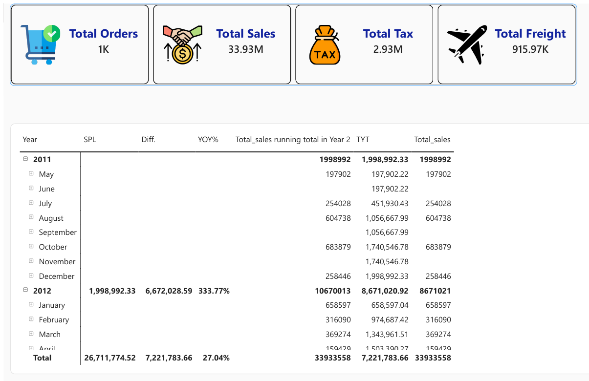

# Sales Dashboard (Power BI, DAX and Star Schema)

> A two-page Power BI report on 33.93M in sales. It combines KPI cards, sales by territory and product, and a year-over-year view built with time-intelligence DAX measures.



## 🎯 Business Question

How are sales performing, and where do they come from? Specifically:

- What are total sales, orders, tax and freight?
- Which territories and products generate the most sales?
- How do sales change from year to year, and how much has been earned so far in each year?

## 📁 Data Model

A star schema with one fact table and five supporting tables:

| Table | Role |
|---|---|
| `Fact Sales` | Order data: OrderID, TotalDue, TaxAmt, Freight |
| `Dim product` | Product names and sizes |
| `Dim terro` | Sales territories |
| `Dim status` | Order status |
| `Dim ship method` | Shipping method |
| `Calender_Table` | Date table used for the time-intelligence measures |
| `_measures` | A dedicated table that holds all the DAX measures |

## 🛠️ Tools

Power BI Desktop · DAX · Data modeling (star schema)

## 🧮 DAX Measures

```dax
Total_sales   = SUM('Fact Sales'[TotalDue])
Total_Tax     = SUM('Fact Sales'[TaxAmt])
Total_Freight = SUM('Fact Sales'[Freight])
Total_orders  = DISTINCTCOUNT('Fact Sales'[OrderID])

-- Sales for the same period in the previous year
SPL  = CALCULATE([Total_sales], SAMEPERIODLASTYEAR(Calender_Table[Date]))

-- Difference from the same period last year
Diff. = IF(ISBLANK([SPL]), BLANK(), [Total_sales] - [SPL])

-- Year-over-year percentage change from the same period last year
YOY% = IF([SPL] = BLANK(), BLANK(), ([Total_sales] - [SPL]) / [SPL])

-- Year-to-date total
TYT  = TOTALYTD([Total_sales], Calender_Table[Date])
```

## 📑 Report Pages

1. **Page 1 ("Graphs"):** four KPI cards (orders, sales, tax, freight), total sales by territory and total sales by product.
2. **Page 2 ("Insights"):** a Year → Month → Day matrix, sorted by year and calendar month, with the same period last year, the difference, the year-over-year percentage change, a running total, the year-to-date total and total sales.



## 🔍 Key Findings

- **Total sales are 33.93M**, with 2.93M in tax (8.6% of sales) and 915.97K in freight (2.7%).
- **Canada leads by a wide margin** with 11.9M, about 35% of total sales. Northwest follows with 6.9M, and together the two bring in about 55% of the total.
- **Mountain-200 bikes dominate the product chart.** Six of the ten products shown are Mountain-200 variants, led by Mountain-200 Black, 38 at 1.53M. Three are Touring-1000 variants, and one is Road-250 Black, 44 at 0.76M.
- **The ten products shown add up to about 9.8M**, roughly 29% of total sales.
- **Sales peaked in 2013** at 16.04M, about 85% higher than 2012 (8.67M).
- **2014 sales fell 54.98%** from 2013 to 7.22M, a drop of 8.82M. The year totals (2011 to 2014) add up to the 33.93M grand total.

## ⚠️ Data Notes

- 2011 starts in May, so the 333.77% growth shown for 2012 compares against a partial year. June, September and November 2011 have no sales, so their year-to-date values simply carry over from the previous month.
- Check that 2014 is a complete year before treating its drop as a real decline.
- The currency is not stated in the report.

## ✅ Next Steps

- **Add a year slicer and a line chart** of sales over time.

## 📂 Files

- `powerbi/sales-dashboard.pbix` – the Power BI report (open it with Power BI Desktop)
- `images/` – screenshots of the report pages

## 👤 Author

Mohamed EL Maghawry · [LinkedIn](https://www.linkedin.com/in/mohamed-el-maghawry-a60232b4) · maghawry.17@gmail.com
